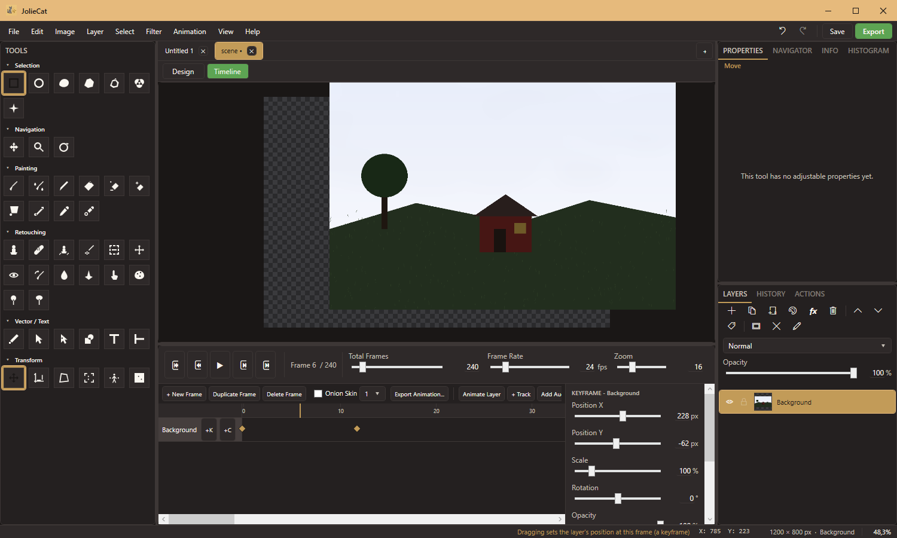
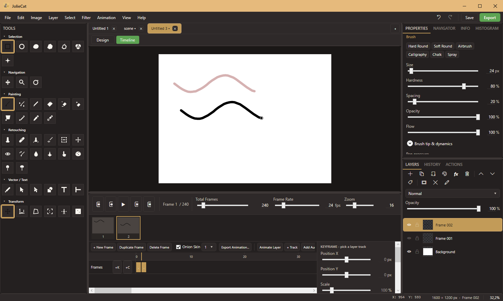
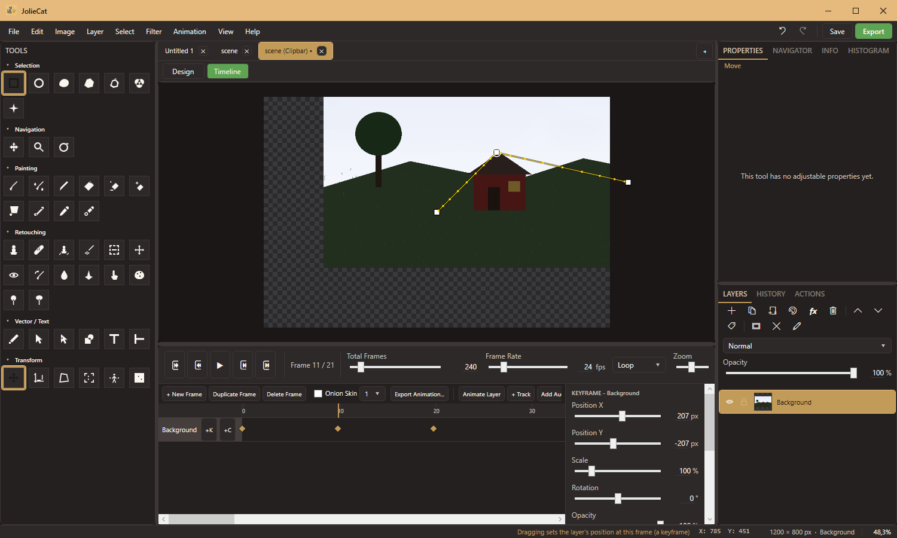
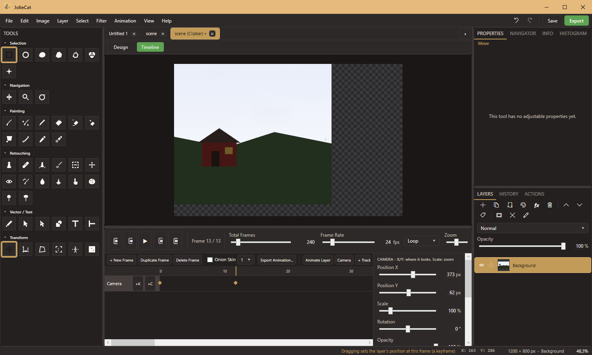

# Sprite Sheet & Clipbar Animation Workflow Guide

JolieCat has two project types built specifically around sprite-based
animation, on top of the general editor described in
[`UserGuide.md`](UserGuide.md):

- **Type 2 — Sprite Sheet**: a canvas with a configurable slicing grid
  overlay, for laying out and exporting individual frames from one sheet.
- **Type 3 — Clipbar Animation**: a dedicated Timeline workspace — tracks,
  clips, keyframes, a scrubbable playhead, and playback transport — for
  frame-by-frame animation.

The two are designed to connect directly: build and lay out your frames as a
Sprite Sheet, then **derive** a Clipbar Animation project from it with one
command. Each grid cell becomes its own frame layer and its own Timeline
clip automatically — you don't re-import or re-slice anything by hand.

## Part 1 — Sprite Sheet (Type 2)

### Creating a Sprite Sheet project

**File → New** (`Ctrl+N`) → choose **Sprite Sheet** in the New Project
dialog → **Create**. This opens a normal canvas plus:

- A slicing **grid overlay** drawn over the canvas.
- A **Sprite Sheet Grid** panel (in the right-hand Properties/Layers
  column), for configuring that grid.
- Marquee selection tools snap to the grid's lines automatically when
  **Snap Marquee to Grid** is checked, so hand-placed selections land
  exactly on cell boundaries.

Build your sheet like any other document — add layers, paint, import
reference images, etc. — using the grid overlay to see where each frame's
boundaries fall.

### Configuring the grid

The Sprite Sheet Grid panel has six settings, all live-updating the overlay
immediately:

| Setting | What it controls |
|---|---|
| **Columns** | Number of cells across (1–64). |
| **Rows** | Number of cells down (1–64). |
| **Padding X / Padding Y** | Spacing between adjacent cells, in document pixels. |
| **Margin X / Margin Y** | Border around the whole grid before the first row/column starts, in document pixels. |
| **Snap Marquee to Grid** | When checked, Marquee selections snap to the nearest grid line on each axis. |

Cell size is always *derived* from these settings plus the document's own
width/height — you never set a cell's size directly, which keeps the column/
row count, padding, and margin from ever disagreeing with the actual canvas
dimensions. Cells are numbered **row-major**: row 0's columns left-to-right,
then row 1's, and so on — this is the exact order both exporting and
deriving a Clipbar Animation use.

If you need a different overall canvas size once the grid layout is set,
use **Resize Canvas...** (see `UserGuide.md`) — the grid recalculates
against the new dimensions automatically.

### Slicing & exporting frames

**Slice & Export Frames...** (in the Sprite Sheet Grid panel) flattens the
document and writes one image file per grid cell:

1. Click the button — a folder-picker dialog opens.
2. Choose a destination folder.
3. Every cell is cropped from the flattened composite and written as its own
   file, named `<document title>_<index>.<ext>` — zero-padded to three
   digits, e.g. `Untitled 1_000.png`, `Untitled 1_001.png`, `Untitled
   1_002.png`, ... — in the same row-major order the grid itself uses.
   The format is always PNG.
4. A cell whose configured rectangle has collapsed to nothing (e.g. margins/
   padding too large for the grid) is skipped — but its index is still
   consumed, so a later cell's number always matches its actual position in
   the grid rather than shifting down to fill the gap.
5. The status bar confirms how many frames were written.

This is a one-off export for use outside JolieCat (a game engine's own
import pipeline, sharing a set of individual frame images, etc.) — it
doesn't affect the Sprite Sheet document itself and doesn't require or
produce a Clipbar Animation project.

### Detect Grid

**Detect Grid** (under the six sliders) reads the grid off the picture: the
empty space between the sprites becomes the padding, the space before the
first sprite the margin, and the number of sprite columns and rows the grid
size. Empty space means see-through pixels, or, on a sheet with no
see-through pixels at all, the color of its top-left corner. Use it on a
sheet you opened from somewhere else instead of measuring it by hand. If the
sprites touch each other, no grid shows and a message says so.

### Pack Sprites into Sheet

**File → Pack Sprites into Sheet...** builds a new Sprite Sheet from
separate pictures (or from the frames of an animated GIF or WebP). Pick the
files; they go in name order. Each cell is as big as the largest picture,
smaller pictures sit in the middle of their cell, the grid is close to
square, and there are 2 px between cells. The grid panel is already set to
match.

### Import Sprite Atlas

**File → Import Sprite Atlas...** opens an atlas made by TexturePacker,
Aseprite, JolieCat or a similar tool: pick its `.json`. The picture is
found next to it (the name written in the `.json`, or the same name as
`.png`); if it isn't there, you're asked for it. Every sprite comes back
at its original size, including trimmed sprites and sprites the packer
turned sideways. If the `.json` lists animations (an `animations` block,
or Aseprite's tags), each animation becomes one row of the new Sprite
Sheet, with **Row Names** already filled in. Sprites outside any
animation follow in the rows after them. Exporting from JolieCat and
importing back gives the same sheet.

### Preview

**Play Cells** (in the panel's PREVIEW part) plays the cells one after
another in a small window under the panel, at the **FPS** you set. Empty
cells are left out. **Row** plays only one row (1 = the top row; 0 = every
cell), since a sheet often keeps one move per row: walk, jump, attack. The
preview follows grid changes as you make them.

### Export for Game Engines

**Export for Game Engines...** writes the sheet as a PNG and, next to it, a
`.json` file with the same name, in the TexturePacker "hash" layout that the
Phaser and PixiJS loaders and the usual Godot and Unity importers read:

- one entry per non-empty cell, named `<file name>_000`, `_001`, ...
- `frame`: where the cell is on the sheet;
- `spriteSourceSize` and `trimmed`: the part of the cell that holds pixels;
- `pivot`: the middle of the bottom edge (where a character stands);
- `cell`: its column and row; `meta.grid`: the grid settings;
- `animations`: one list of frame names per named row (see below).

### Export options

Both exports first ask for the **Data Format**:

- **JSON (hash)** — frames by name (Phaser, PixiJS, Godot and Unity importers);
- **JSON (array)** — frames in order, each with a `filename` (Phaser, Construct);
- **CSS** — a `.css` file with one class per frame for web pages
  (`class="sprite walk_003"`).

**Export Packed Atlas** also has:

- **Padding** — empty pixels between sprites;
- **Extrude** — each sprite's edge pixels repeated that many times around it,
  so a game's texture filtering never picks up a sliver of the neighbouring
  sprite (the frame rectangles in the data stay the sprite itself);
- **Power-of-2 Size** — makes the atlas's width and height powers of two
  (256, 512, 1024...), for older engines and graphics cards.

### Cells

**Cells...** in the panel changes cells of the active layer: **Swap Two
Cells**, **Copy Cell To** another, **Clear Cell**, **Flip Cell
Horizontally / Vertically**. Cells are numbered from 1, left to right, top
to bottom. Each change is one undo step.

The same dialog's **Set Cell Pivot** gives one cell its own pivot (Pivot X /
Y in percent of the cell) instead of the sheet's: a sword swing's pivot at
the hand, say. **Reset Cell Pivot** puts it back. The orange cross on the
canvas shows each cell's pivot, the exports write it, and it's saved with the
project.

### Row names (animations)

Sheets usually keep one move per row: walk, jump, attack. Type the names in
**Row Names**, top row first, separated by commas (`walk, jump, attack`).
Both exports (**Export for Game Engines** and **Export Packed Atlas**) then
add an `animations` block that lists each named row's frames in order. The
PixiJS and Phaser loaders turn it straight into playable animations. Rows
without a name are left out of it; two rows with the same name are joined
into one animation. The names are saved with the project.

## Part 2 — Deriving a Clipbar Animation (Type 2 → Type 3)

### Running the derivation

Once your Sprite Sheet's grid and content are laid out the way you want,
**Derive Clipbar Animation...** (right below **Slice & Export Frames...** in
the same panel) builds a complete Clipbar Animation project from it in one
step:

1. Click **Derive Clipbar Animation...**.
2. A brand new document tab opens, titled `<source title> (Clipbar)`,
   already active.

No dialog or extra input is needed — the conversion uses the source
document's current grid settings and flattened content directly. Under the
hood, this is what happens:

- The source Sprite Sheet's flattened composite is sliced into the grid's
  cells, in the same row-major order slicing-to-files uses.
- **Each cell becomes its own layer** in the new document, sized to exactly
  one grid cell, named `Frame 000`, `Frame 001`, `Frame 002`, ... in cell
  order. Only `Frame 000` starts visible — every later frame layer starts
  hidden, so the new project opens showing just its first frame rather than
  every frame's pixels stacked on top of one another.
- **One Timeline track named "Frames"** is created, with one clip per frame
  layer — `Frame 000` occupying frame 0, `Frame 001` occupying frame 1, and
  so on, each one frame long — positioned sequentially and already wired so
  each clip drives its own matching frame layer's visibility (see
  [Frame-layer playback](#frame-layer-playback-how-clips-drive-visibility)
  below).
- The new project's frame rate is carried over from whatever frame rate the
  source document's Timeline was already set to (24 fps by default, if
  never changed).
- The Sprite Sheet's grid settings themselves are copied into the new
  document only for provenance — they're not shown or editable there, since
  a Clipbar Animation project's canvas is a single frame's size, not a
  multi-cell sheet.
- A degenerate cell (collapsed to nothing) is skipped exactly like the
  file-slicing export skips it, and still counts toward the frame numbering.

The source Sprite Sheet document is left completely untouched — deriving a
Clipbar Animation opens a new, independent tab rather than converting the
one you ran the command from.

## Part 3 — The Clipbar Animation Workspace (Type 3)

> **Animation lives in Clipbar Animation projects** — their own project
> type (File → New → Clipbar Animation, or derived from a Sprite Sheet). The
> **Animation** menu (between Filter and View) has every command — Show
> Timeline (`Shift+Ctrl+T`), Play, Next / Previous Frame, New / Duplicate /
> Delete Frame, Onion Skin, Animate Layer, Add Audio, Import Frames, Export
> Animation — and each opens the Timeline under the canvas. In a Standard
> Image or Sprite Sheet document these are greyed out; **Animation →
> Convert to Clipbar Animation...** opens a copy of that document as a
> Clipbar Animation project (the original stays as it is).

You can also create a Clipbar Animation project directly (**File → New** →
**Clipbar Animation**) rather than deriving one, if you're building
frame-by-frame animation from scratch instead of from a pre-built sheet.

A Clipbar Animation document opens in **Timeline** mode: the canvas stays on
top, and the Timeline sits under it (drag the bar between them to give
either more room). **Design** hides the Timeline for plain editing. The
Timeline has two parts:

### Playback transport bar

Along the top:

| Control | Action |
|---|---|
| ⏮ | Go to start (frame 0) |
| ⏪ | Previous frame |
| ▶ / ⏸ | Play / Pause — auto-advances the playhead at the current frame rate, looping back to frame 0 once it passes the last frame |
| ⏩ | Next frame |
| ⏭ | Go to end (last frame) |
| **Total Frames** | The animation's total length, in frames (1–2000) |
| **Frame Rate** | Playback speed, in frames per second (1–120) |
| **In / Out / ×** | The work area: **In** and **Out** set the first and last frame to play and export (shaded on the ruler); **×** clears it, back to the whole animation. Saved with the project. Also in the Animation menu. |
| **Loop / Once / PingPong** | How playback repeats: over and over, a single time (stopping on the last frame), or forward then backward. Exported GIFs follow it too. |
| **Zoom** | How wide each frame is drawn on the Timeline |

Playback loops over the animation itself: from frame 0 to the end of the
last clip.

### Drawing frame by frame

The toolbar above the tracks:

| Button | Action |
|---|---|
| **+ New Frame** | Adds a blank frame after the current one — a new layer (`Frame 001`, `Frame 002`, ...) that becomes the active layer, so you draw straight onto it. The bottom (background) layer is never made a frame: it stays visible behind every frame. If you had already drawn on another layer, that layer becomes frame 1. |
| **Duplicate Frame** | Adds a copy of the current frame after it — draw the next pose by changing the copy. |
| **Delete Frame** | Deletes the current frame and its layer; later frames move up. |
| **Onion Skin** | Shows the frames before (red) and after (green) faintly over the canvas, to line up the next drawing. The number next to it is how many frames each way (1–3). |
| **Export Animation...** | See below. |

**The frame strip** above the tracks shows every frame as a small picture,
numbered from 1 (`2 ×3` means frame 2 is held for 3 timeline frames); the
current one is outlined. Click a picture to go to that frame.
**Right-click** a picture for: **Show For** 1, 2, 3, 4, 6, 8 or 12 frames
(how long that drawing stays on screen — later frames move along), **Move
Earlier / Move Later** (reorder), **Duplicate Frame** and **Delete Frame**.
All of these can be undone. The counter
in the transport bar reads the same way: *Frame 3 / 12* is the third frame
of a 12-frame animation.

**Animation → Import Frames...** brings frames in from an **animated GIF**
(each GIF frame keeps its timing) or from **several pictures** (one frame
each, in file-name order). Pictures of another size are fitted into the
canvas, centered. One undo step.

**Frames with several layers:** **Animation → Make Frames Multi-layer** turns
every frame into a group (named like the frame, with its drawing inside as
a layer called *Drawing*). Add more layers inside a frame's group — colors
under the lines, a shadow — and they show and hide with that frame. New
Frame then makes a new group with an empty *Drawing* layer, Duplicate Frame
copies a frame with all its layers, and moving to another frame keeps you
on the same-named layer (from *Color* on frame 3 to *Color* on frame 4).

Frames live on the **Frames** track: each clip shows its layer for as long
as the playhead is over it. Drag a clip's right edge to hold that drawing
for more frames. Moving the playhead (or stepping with ⏪ / ⏩) also makes
that frame's layer the active one.

Stepping or jumping the playhead always pauses playback first, so a scrub
gesture never fights an in-progress auto-advance.

### Tracks, clips, and keyframes

Below the transport bar, the timeline itself:

- **+ Track** (toolbar button) adds a new, empty track, named
  `Track <n>`.
- Each track row has its own **+K** (add keyframe at playhead) and **+C**
  (add clip at playhead, 24 frames long) buttons.
- **Clips** are the colored bars in a track's lane — drag a clip's body to
  move it, or drag either edge to trim its length.
- **Keyframes** are the diamond markers on a track's lane, placed at the
  playhead's current position.
- The **playhead** (the vertical line over the ruler) can be dragged
  directly to scrub through the animation.
- The frame ruler and every track lane share the same horizontal frame-to-
  pixel scale, so everything lines up regardless of how far you've scrolled.

### Frame-layer playback (how clips drive visibility)

A clip derived from a Sprite Sheet (see Part 2) is wired to its own frame
layer by name. As the playhead moves, JolieCat shows exactly the layer(s)
whose clip currently contains the playhead's frame, and hides every other
wired layer — a "flipbook" effect, not general per-property interpolation.
Reopening a saved Clipbar Animation project re-establishes these same
layer/clip connections automatically.

### Keyframe animation (moving, scaling, turning, fading a layer)

1. Select the layer — or a group — to animate and click **Animate Layer**. A track named
   after the layer appears, with a first keyframe (a diamond) at the
   playhead holding the layer as it is.
2. Move the playhead to a later frame and change a value in the
   **Keyframe** panel on the right — **Position X / Y** (pixels from where
   the layer was drawn), **Scale**, **Rotation** (around the middle of the
   layer's content), **Opacity** or **Blur** (in pixels: 0 is sharp; key it
   up and back down for a focus pull, or blur a fast move so it smears;
   on a group, the whole group blurs together). A
   keyframe is set there automatically;
   changing more values at the same frame updates that keyframe.
3. Press ▶: between keyframes the layer moves smoothly. **To next key** sets
   how each keyframe moves on to the next one: **EaseInOut** (default —
   starts and ends gently), **Linear** (constant speed), **EaseIn** /
   **EaseOut** (gentle start / gentle stop only), or **Hold** (no
   in-between: it stays, then jumps at the next key), or **Custom** — your
   own speed curve: a small graph shows it (time to the right, progress
   up), the four **Handle** sliders shape it like CSS `cubic-bezier`, and
   ready-made ones are in the list above them (Ease, Ease In, Ease Out,
   Ease In Out, **Back** — overshoots, then settles — and **Anticipate** —
   pulls back first).

**Drag a keyframe** (the diamond) along its track to move it in time;
clicking one jumps the playhead to it. **Copy Pose** / **Paste Pose** copy a
pose from one frame to another (or between layers).

**Bones (attaching layers):** put each part of a character on its own layer
(upper arm, forearm, hand...) and give each an Animate Layer track. On a
part's track, **Attached to** picks the part it hangs from — the forearm
attached to the upper arm, the hand to the forearm. An attached part moves,
scales and turns along with its parent, plus whatever its own keyframes
add: turn the upper arm and the whole arm swings. **Joint X / Y** set the
point a part turns around (the elbow, not the middle of the forearm) —
shown on the canvas as a blue ringed cross; **Joint to Middle** puts it
back. A part can't be attached to its own child, so the chain never loops.
Attachments and joints are saved and can be undone.

**Color effects:** the Keyframe panel also has **Brightness** (-100 fades
to black, +100 flashes to white), **Saturation** (0% black and white, 100%
as drawn, 200% extra vivid) and **Hue** (every color turned around the color
wheel). They are keyed like the other values, so a layer can fade to black,
lose its color, or change color over time. On a group, the whole group
changes together.

**Wiggle:** on a layer's track, **Wiggle** (how far, px), **Wiggle Turn**
(how much it turns, degrees) and **Wiggle Speed** (shakes a second) make the
layer jitter by itself, smoothly and never quite repeating: a shivering
character, a flickering flame, a hand-held look. It needs no keyframes, adds
to whatever the keys do, and each layer wiggles differently. Saved with the
project; undoable.

**Move Along Path:** draw the route with the **Pen** tool, select the layer's
track, put the playhead where the move starts, and choose **Animation →
Move Along Path...**. Set how many **Frames** the trip takes; **Turn to
Follow the Path** makes the layer face the way it's going. The layer's middle
travels along the path at an even speed (a key every frame). One undo step.

**Reverse Keyframes** (Animation menu) plays the selected keys — or, with
none selected, all of the selected layer's — backwards over the same frames
(a gentle start becomes a gentle stop). **Stretch Keyframes...** spreads them
out or squeezes them together in time from the first one: 200% plays twice as
slow, 50% twice as fast.

**Hearing the sound while scrubbing:** dragging the playhead (or stepping
frame by frame) plays a moment of the sound at that spot, so you can find a
beat or a word to time a move to.

**Motion blur:** tick **Motion Blur** in the Keyframe panel (on a layer's
track) and fast moves and turns smear along the motion, like a film camera:
each frame shows the layer at 8 moments spread over half a frame, averaged.
Slow or still parts stay sharp. It shows in the preview and in every export,
is saved with the project, and can be undone. On a group, its layers smear
together as one picture.

**Bending one drawing:** to bend a single drawn part instead of cutting it
into pieces (an arm bending at the elbow, a tail, a blade of grass), use
**Bend** in the Keyframe panel. **Bend Point X / Y** set where it bends
(shown on the canvas as a pink diamond). The part on the far side of the
bend point, seen from the **Joint**, turns around it by the Bend angle, with
a smooth curve across the bend rather than a sharp fold. Bend is keyed like
the other values: 0° at one key and 60° at a later one bends the arm
gradually. If the joint and the bend point are in the same place, the part
to the right of the point bends. The bend point is saved with the project. Bend
works on a group too: its layers (sleeve, arm, hand) bend together as one
picture.

**Typing text out:** on a track for a **text layer** the Keyframe panel also
has **Text Reveal** — how much of the text shows. Set 0% at one keyframe
and 100% at a later one, and the text appears letter by letter (the text
itself stays editable).

**Several keys at once:** Shift+click diamonds to select several (selected
ones turn white, on any tracks); dragging one moves them all by the same
number of frames. In the Keyframe panel, **Copy** remembers the selected
keys of the track, **Paste at Playhead** puts them on the selected track
with the first at the playhead (spacing kept — handy for repeating a
motion), and **Delete** removes them.

**Motion path:** with a layer track selected, the canvas shows the path the
layer's middle travels — a dot for every frame (closer together where it
moves slowly), a white square at each keyframe, a ring at the current
frame.

Click a track's name to edit it in the Keyframe panel. **+K** on a track adds
a keyframe at the playhead holding the current pose; **Delete Key at
Playhead** removes one. The layer's pixels are never changed — the
animation only changes how it's drawn — and it's saved with the project
and included in **Export Animation**. Several layers can each have their own
track.

**Dragging on the canvas:** in Timeline mode, the **Move** tool on an
animated layer (or on a layer inside an animated group) doesn't move its
pixels — it sets the layer's position at the current frame, adding or
updating a keyframe there.

**Animating a group** moves everything in it together: put the frames of a
character drawn frame by frame into a group (select them, `Ctrl+G`),
animate the group, and the character walks across the scene while its
frames flip.

Plain tracks added with **+ Track** (not for a layer) and their **+C** clips
don't change the picture; they can be used as markers.

### Markers

**Animation → Add Marker...** puts a named marker (a beat, a footstep, a
word) at the playhead, on a blue **Markers** track — drag one to move it.
**Next Marker / Previous Marker** jump the playhead between them. Markers
are saved with the project, can be undone, and don't change how long the
animation is.

### Camera

**Animation → Add Camera** (or **Camera** on the Timeline toolbar) adds a
**Camera** track: its keyframes zoom, pan, turn and fade the **whole
picture** — a slow zoom into a still, a pan across a wide drawing, a fade
in or out. With the Camera track selected, the Keyframe panel edits it:
**Position X / Y** is where the camera looks (pixels from the middle),
**Scale** is the zoom (200% = twice as close), **Rotation** turns it,
**Opacity** fades the picture. The **Move** tool pans the camera too
(drag the picture the way you want it to go).

The canvas shows the camera's view while playing and while the Camera
track is selected; while you draw on frames or layers it shows the picture
as it is, so strokes land where you see them. Exports always go through
the camera. Panning past the picture's edge shows emptiness (transparent,
white in MP4) — zoom in a little to avoid it.

### Sound

**Add Audio...** (Timeline toolbar) adds a sound — WAV, MP3, M4A, WMA or
AAC — on its own green track, starting at the playhead; its clip is as long
as the sound. Drag the clip to move the sound in time. It plays along when
you press ▶ (it starts when the playhead reaches it), and it goes into
**MP4 Video** exports, cut off where the video ends. If the sound is longer
than the animation, playback and export run until the sound ends, the last
picture held.

The clip shows the sound's **waveform**, so you can line up drawings with
beats, steps or words. Click the track's name to get its **Volume** and
**Mute** on the right-hand panel (both are saved and can be undone; muted
sounds are left out of exported videos).

The sound is **stored inside the project** when you save, so the project
can be moved to another computer or shared and still plays its sound
(when opened, it is unpacked to `%LocalAppData%\JolieCat\AudioCache`).

### Undo

Everything on the Timeline can be undone (`Ctrl+Z`) like any other edit:
New / Duplicate / Delete Frame (the frame and its layer together, as one
step), keyframes, Animate Layer, new tracks, clips and sounds, and moving or
trimming a clip. Dragging a slider in the Keyframe panel is one step, not
one per tiny move.

### Saving and exporting

- **Save** (`Ctrl+S`) writes the Timeline's tracks, clips, and keyframe
  positions into the `.jolie` file along with every layer, exactly like any
  other project type.
- **Export Animation...** (Timeline toolbar, or File → Export Animation)
  saves the frames as:
  - an **Animated GIF** that loops forever (held frames keep their length),
  - an **Animated PNG (transparent)** — full color with transparency (no
    background needed, unlike GIF's 256 colors or MP4's white), played by
    every current web browser; viewers that don't know animated PNG show
    its first frame,
  - an **MP4 Video** (H.264, made with Windows' own encoder — nothing to
    install). Transparent areas become white; animations smaller than
    160 × 120 are enlarged by a whole factor, keeping pixel art sharp,
  - a **PNG Sequence** — one numbered file per timeline frame
    (`name_000.png`, `name_001.png`, ...), for video tools and game engines,
  - a **Sprite Sheet (PNG)** — every distinct drawing in one image, in a
    near-square grid, row by row, with a **.json** file of the same name
    next to it listing each frame's position, size and duration (for game
    engines).

  **Size** scales the output (e.g. 50% for a smaller GIF).
